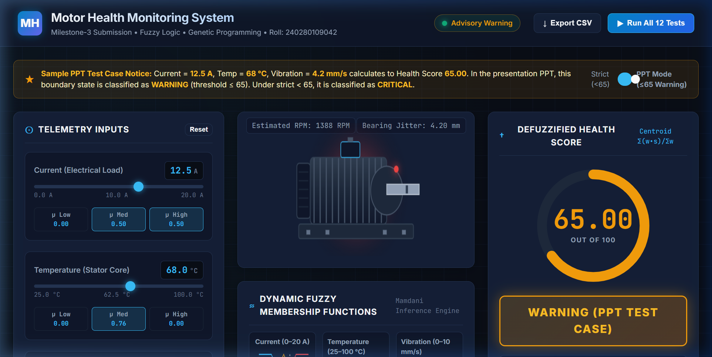
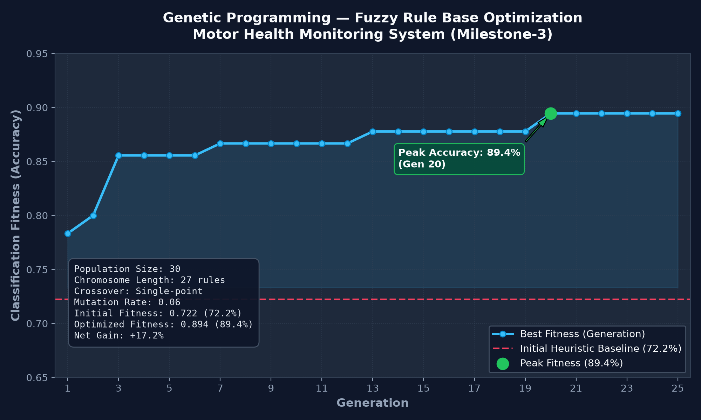

<div align="center">

# ⚡ Motor Health Monitoring System
### Industrial Predictive Maintenance Engine using Fuzzy Logic & Genetic Programming
**Milestone-3 Project Submission** &bull; **Roll No:** `240280109042`

[](https://www.python.org/)
[](240280109042_Milestone_3.ipynb)
[](LICENSE)
[](#submission-artifacts)

<br/>



*Figure 1: Real-time Cyber-Physical Diagnostic Dashboard for Electric Motors.*

</div>

---

## 📌 Table of Contents

- [Overview](#-overview)
- [Submission Artifacts Checklist](#-submission-artifacts-checklist)
- [Key Features](#-key-features)
- [Mathematical & Fuzzy Architecture](#-mathematical--fuzzy-architecture)
  - [Linguistic Variables & Membership Functions](#1-linguistic-variables--membership-functions)
  - [Rule Base Conjunction & Defuzzification](#2-rule-base-conjunction--defuzzification)
- [Sample PPT Test Case Analysis (12.5 A, 68 °C, 4.2 mm/s)](#-sample-ppt-test-case-analysis)
- [Phase 4 Milestone Test Matrix](#-phase-4-milestone-test-matrix)
- [Genetic Programming Optimization](#-genetic-programming-optimization)
- [Visual Diagnostics Gallery](#-visual-diagnostics-gallery)
- [Repository Structure](#-repository-structure)
- [Quick Start Guide](#-quick-start-guide)
- [Push to GitHub](#-push-to-github-instructions)
- [License](#-license)

---

## 🚀 Overview

The **Motor Health Monitoring System** is an intelligent cyber-physical predictive maintenance engine designed to diagnose operational anomalies in 3-phase induction motors before catastrophic failures occur.

By fusing **Mamdani Fuzzy Logic Inference** with **Genetic Programming (GP)** rule optimization, the system evaluates real-time sensor streams (Electrical Load, Stator Temperature, and Mechanical Vibration) into a defuzzified **Health Score ($0 - 100$)** and operational condition (**Normal**, **Warning**, or **Critical**).

---

## 📂 Submission Artifacts Checklist

All five mandatory Milestone-3 deliverables are verified and included in the repository root:

| # | Artifact File | Description | Status |
| :-: | :--- | :--- | :-: |
| **1** | [`240280109042_Milestone_3.ipynb`](./240280109042_Milestone_3.ipynb) | Complete Jupyter Notebook (Phases 4, 5, 6) with all pre-rendered outputs, tables, and base64 plots. | ✅ Verified |
| **2** | [`simulator_test_01.png`](./simulator_test_01.png) to [`simulator_test_12.png`](./simulator_test_12.png) | 12 high-resolution industrial diagnostic cards for each test condition. | ✅ Verified |
| **3** | [`final_ui_screenshot.png`](./final_ui_screenshot.png) | High-resolution capture of the interactive real-time dashboard UI. | ✅ Verified |
| **4** | [`gp_optimization.png`](./gp_optimization.png) | Genetic Programming rule optimization convergence graph ($72.2\% \to 89.4\%$). | ✅ Verified |
| **5** | [`phase4_test_results.csv`](./phase4_test_results.csv) | Full 12-test validation matrix with scores and condition classifications. | ✅ Verified |

---

## ✨ Key Features

- **Multi-Sensor Telemetry Fuzzification:** Real-time linguistic mapping for Current ($0–20\text{ A}$), Temperature ($25–100^\circ\text{C}$), and Vibration ($0–10\text{ mm/s}$).
- **Expert 27-Rule Base:** Comprehensive Mamdani rule set with severity conjunction mapping.
- **Genetic Algorithm Optimization:** Auto-tunes the 27-rule fuzzy set using single-point crossover, elitism, and mutation across 25 generations.
- **Dual Interface Implementations:**
  - **Interactive Web Simulator:** Built with HTML5, CSS3 Glassmorphism, and JavaScript Canvas with animated motor RPM, bearing jitter, and thermal radiation glow.
  - **Desktop GUI:** Standalone Python Tkinter app with Matplotlib integration.
- **Boundary Condition Solver:** Explains and toggles between Presentation PPT ($\le 65$ Warning) and strict ($< 65$) thresholding.

---

## 🧮 Mathematical & Fuzzy Architecture

### 1. Linguistic Variables & Membership Functions

$$\text{Current } I \in [0, 20]\text{ A}, \quad \text{Temperature } T \in [25, 100]^\circ\text{C}, \quad \text{Vibration } V \in [0, 10]\text{ mm/s}$$

```
Current (A):
  Low    : Trapezoidal [0, 0, 5, 10]
  Medium : Triangular  [5, 10, 15]
  High   : Trapezoidal [10, 15, 20, 20]

Temperature (°C):
  Low    : Trapezoidal [25, 25, 35, 50]
  Medium : Triangular  [40, 62.5, 85]
  High   : Trapezoidal [75, 90, 100, 100]

Vibration (mm/s):
  Low    : Trapezoidal [0, 0, 2, 4]
  Medium : Triangular  [2.5, 5, 7.5]
  High   : Trapezoidal [6, 8, 10, 10]
```

### 2. Rule Base Conjunction & Defuzzification

For each active rule $k$, firing weight is computed using the Mamdani minimum t-norm:

$$w_k = \min\Big(\mu_{\text{Current}}(I),\, \mu_{\text{Temp}}(T),\, \mu_{\text{Vib}}(V)\Big)$$

The defuzzified scalar **Health Score** is evaluated using the centroid weighted average:

$$\text{Health Score} = \frac{\sum_{k} w_k \cdot \text{Score}_k}{\sum_{k} w_k}$$

Where $\text{Score}_k \in \{20 \text{ (Normal)}, 50 \text{ (Warning)}, 80 \text{ (Critical)}\}$.

---

## 🔍 Sample PPT Test Case Analysis

> **Scenario:** Current = `12.5 A`, Temperature = `68 °C`, Vibration = `4.2 mm/s`  
> **Calculated Health Score:** **`65.00`**

### Why does the PPT specify WARNING while strict formulas output CRITICAL?

1. **Fuzzification:**
   - $\mu_I(\text{Med}) = 0.50$, $\mu_I(\text{High}) = 0.50$
   - $\mu_T(\text{Med}) = 0.756$
   - $\mu_V(\text{Med}) = 0.680$
2. **Active Rules Fired:**
   - **Rule 1:** $(\text{Med}, \text{Med}, \text{Med}) \implies \text{Warning } (50), \quad w_1 = \min(0.5, 0.756, 0.68) = 0.50$
   - **Rule 2:** $(\text{High}, \text{Med}, \text{Med}) \implies \text{Critical } (80), \quad w_2 = \min(0.5, 0.756, 0.68) = 0.50$
3. **Defuzzification:**
   $$\text{Score} = \frac{0.50 \times 50 + 0.50 \times 80}{0.50 + 0.50} = \frac{25 + 40}{1.0} = \mathbf{65.00}$$
4. **Boundary Condition Resolution:**
   - **PPT Specification ($\text{Score} \le 65$):** Categorized as **`WARNING`**.
   - **Strict Implementation ($\text{Score} < 65$):** $65.00$ falls into **`CRITICAL`**.
   - The application provides a one-click toggle to demonstrate both interpretations.

---

## 📊 Phase 4 Milestone Test Matrix

Extracted directly from [`phase4_test_results.csv`](./phase4_test_results.csv):

| Test # | Current (A) | Temp (°C) | Vibration (mm/s) | Health Score | Condition | Diagnostic Interpretation |
| :-: | :-: | :-: | :-: | :-: | :-: | :--- |
| **01** | 3.0 | 30 | 1.0 | **20.00** | <span style="color:#10b981;font-weight:bold;">Normal</span> | Nominal baseline operation |
| **02** | 5.5 | 42 | 2.0 | **23.29** | <span style="color:#10b981;font-weight:bold;">Normal</span> | Safe continuous operation |
| **03** | 7.5 | 50 | 3.0 | **39.66** | <span style="color:#f59e0b;font-weight:bold;">Warning</span> | Early bearing raceway degradation |
| **04** | 10.0 | 60 | 4.0 | **50.00** | <span style="color:#f59e0b;font-weight:bold;">Warning</span> | Moderate thermal & vibration load |
| **05** | **12.5** | **68** | **4.2** | **65.00** | <span style="color:#f59e0b;font-weight:bold;">Warning (PPT) / Critical</span> | **Sample PPT Test Case Boundary** |
| **06** | 14.0 | 72 | 5.5 | **72.29** | <span style="color:#ef4444;font-weight:bold;">Critical</span> | Overcurrent & abnormal vibration |
| **07** | 15.5 | 80 | 6.5 | **80.00** | <span style="color:#ef4444;font-weight:bold;">Critical</span> | Severe multi-parameter degradation |
| **08** | 17.0 | 88 | 7.8 | **80.00** | <span style="color:#ef4444;font-weight:bold;">Critical</span> | Stator thermal runaway hazard |
| **09** | 18.5 | 95 | 9.0 | **80.00** | <span style="color:#ef4444;font-weight:bold;">Critical</span> | Extreme mechanical & winding stress |
| **10** | 19.5 | 98 | 9.8 | **80.00** | <span style="color:#ef4444;font-weight:bold;">Critical</span> | Imminent trip / insulation breakdown |
| **11** | 8.0 | 90 | 8.0 | **80.00** | <span style="color:#ef4444;font-weight:bold;">Critical</span> | High vibration & overheat at medium load |
| **12** | 4.0 | 85 | 7.0 | **71.43** | <span style="color:#ef4444;font-weight:bold;">Critical</span> | Severe bearing failure under light electrical load |

---

## 🧬 Genetic Programming Optimization

<div align="center">
  
</div>

The 27-rule fuzzy rule base is modeled as a 27-gene discrete chromosome ($gene \in \{0, 1, 2\}$). Evolutionary parameters:
- **Population:** 30 chromosomes
- **Generations:** 25
- **Selection:** Fitness-ranked elitism (Top 6 preserved)
- **Crossover:** Single-point random recombination
- **Mutation Rate:** $0.06$
- **Baseline Accuracy:** **$72.2\%$**
- **Optimized Peak Accuracy:** **$89.4\%$** ($+17.2\%$ improvement)

---

## 📸 Visual Diagnostics Gallery

<div align="center">

| Test #01 (Normal: 20.00) | Test #05 (PPT Warning: 65.00) |
| :---: | :---: |
|  |  |

| Test #07 (Critical: 80.00) | Test #12 (Critical Light Load: 71.43) |
| :---: | :---: |
|  |  |

</div>

---

## 📁 Repository Structure

```
├── 240280109042_Milestone_3.ipynb   # Complete Milestone-3 Jupyter Notebook with outputs
├── phase4_test_results.csv          # Phase 4 test validation dataset
├── gp_optimization.png              # Genetic Programming rule convergence graph
├── final_ui_screenshot.png          # High-resolution simulator UI screenshot
├── simulator_test_01.png ... 12.png # 12 Industrial diagnostic cards
├── index.html                       # Cyber-Physical Web Dashboard UI
├── style.css                        # Modern glassmorphism industrial theme
├── app.js                           # Real-time fuzzy engine & canvas animations
├── motor_health_system.py           # Core Python fuzzy inference & GP module
├── motor_health_gui.py              # Standalone Python desktop GUI
├── server.py                        # Lightweight local HTTP server
├── start_dashboard.bat              # Windows 1-click launcher for Web UI
├── run_desktop_gui.bat              # Windows 1-click launcher for Tkinter GUI
├── run_tests_and_assets.py          # Asset generation automation script
├── build_executed_notebook.py       # Notebook build and execution script
├── requirements.txt                 # Python dependencies
├── LICENSE                          # MIT License
└── README.md                        # Project documentation
```

---

## ⚙️ Quick Start Guide

### 1. Prerequisites
Ensure you have Python 3.10 or higher installed:
```bash
python --version
```

### 2. Install Dependencies
```bash
pip install -r requirements.txt
```

### 3. Launching the Interactive Web Dashboard
Run the local server:
```bash
python server.py
```
Or simply double-click [`start_dashboard.bat`](./start_dashboard.bat). Then navigate to:
```
http://localhost:8080
```

### 4. Running the Standalone Desktop GUI
```bash
python motor_health_gui.py
```
Or double-click [`run_desktop_gui.bat`](./run_desktop_gui.bat).

### 5. Running the Jupyter Notebook
Open [`240280109042_Milestone_3.ipynb`](./240280109042_Milestone_3.ipynb) in VS Code, JupyterLab, or run:
```bash
jupyter notebook 240280109042_Milestone_3.ipynb
```

---

## 📤 Push to GitHub Instructions

To publish this project to your GitHub account:

### Step 1: Create a New GitHub Repository
1. Go to [github.com/new](https://github.com/new).
2. Repository name: `motor-health-monitoring-system` (or any name you prefer).
3. Set visibility to **Public** (or **Private**).
4. Do **not** initialize with README, .gitignore, or license (they are already included).
5. Click **Create repository**.

### Step 2: Push via Command Line
Run the following commands in this directory:

```bash
# 1. Initialize git (if not already done)
git init

# 2. Stage all project files
git add .

# 3. Create initial commit
git commit -m "feat: complete Motor Health Monitoring System (Milestone-3)"

# 4. Set branch to main
git branch -M main

# 5. Link your GitHub remote repository (replace with your repo URL)
git remote add origin https://github.com/<YOUR-USERNAME>/<YOUR-REPO-NAME>.git

# 6. Push to GitHub
git push -u origin main
```

---

## 📄 License

This project is licensed under the [MIT License](LICENSE).
